# Last Breath

A grim 2D RPG with a living world to explore, turn-based battles and a flexible build system. You are a spawn of the curse that torments this world, awakened at the site of an unknown ritual, trying to piece together what happened and to survive.

As the game is updated, we'll post demos of new mechanics, items, animations, early game builds, and more here.

## What to expect

- **Shape your build** by combining unique and legendary items with the effects you need, a passive skill tree and a wide choice of augments for your active abilities.
- **Put your builds to the test** in turn-based battles against up to 10 enemies at once.
- **Explore the world and the mysterious Depths** in search of worthy opponents, solve riddles, complete quests and earn rewards to match.
- **Craft your gear.** Find and study recipes, create the items you want and imbue them with the properties you need, then refine them and ascend them to Mythic rank.
- **Uncover the origin** of the mysterious curse that has struck the world.

> Early alpha, in active development. Playable build: to be added.

## Showcase

### Inventory

Item cards with rolled modifiers, implicits and item effects, keyword tooltips, filters by rarity and type.

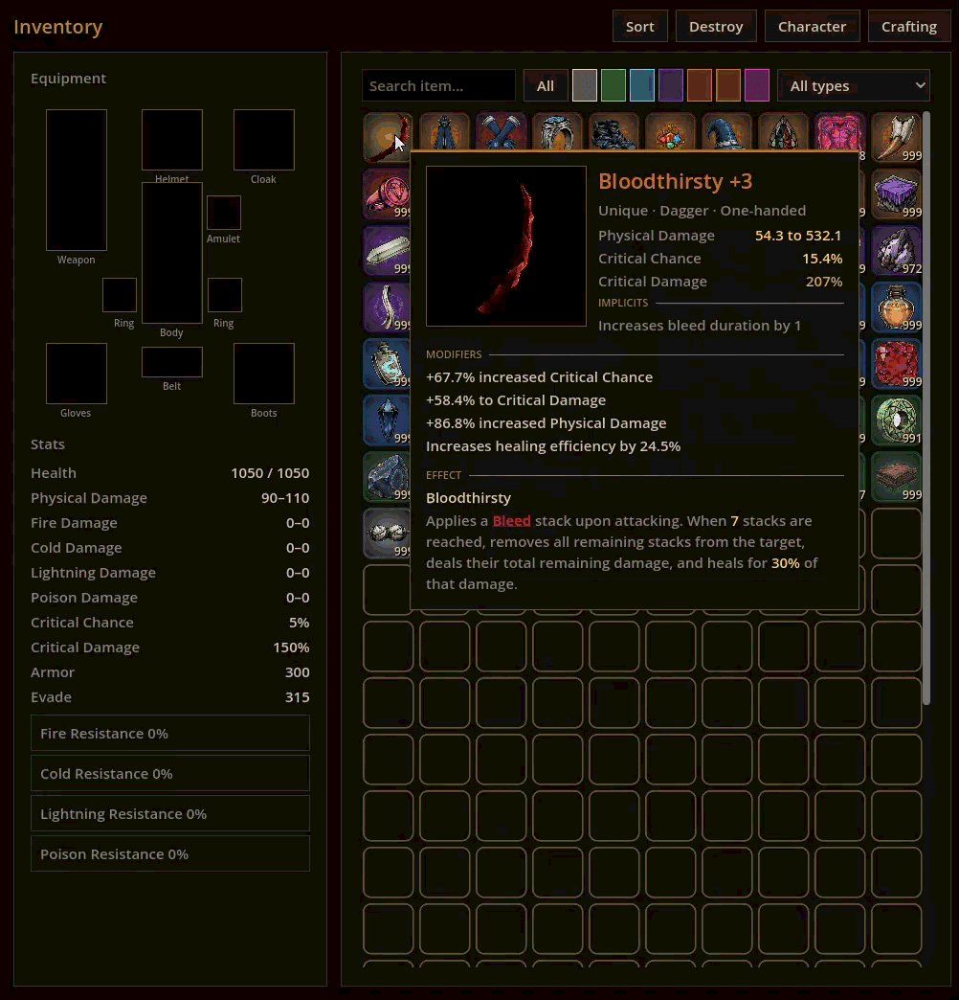

### Crafting

An axe from recipe to Mythic: forging with runes and essences, upgrading with fluxes, rerolling a single modifier, ascending. Click a screenshot to open it full size.

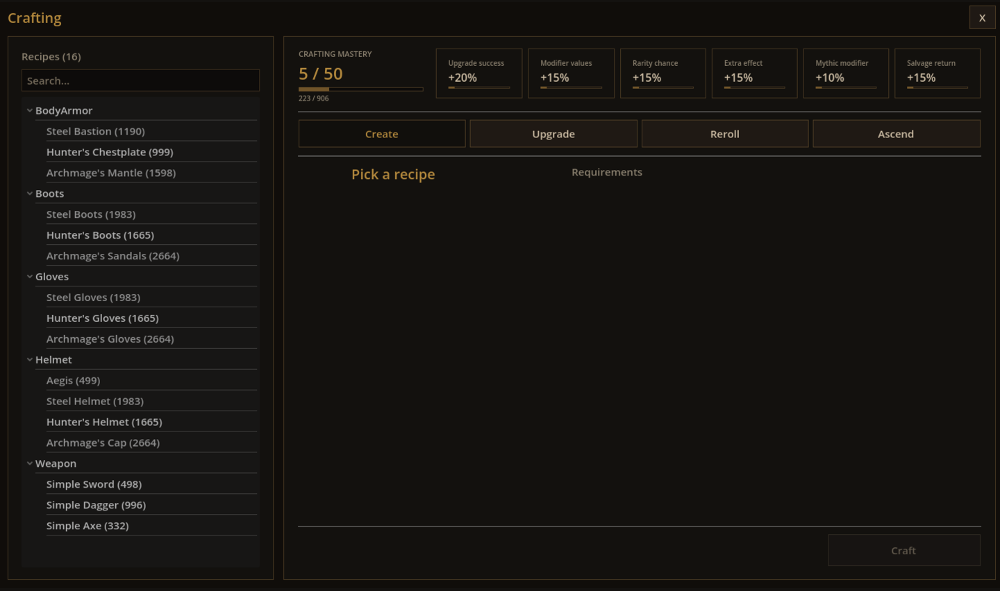
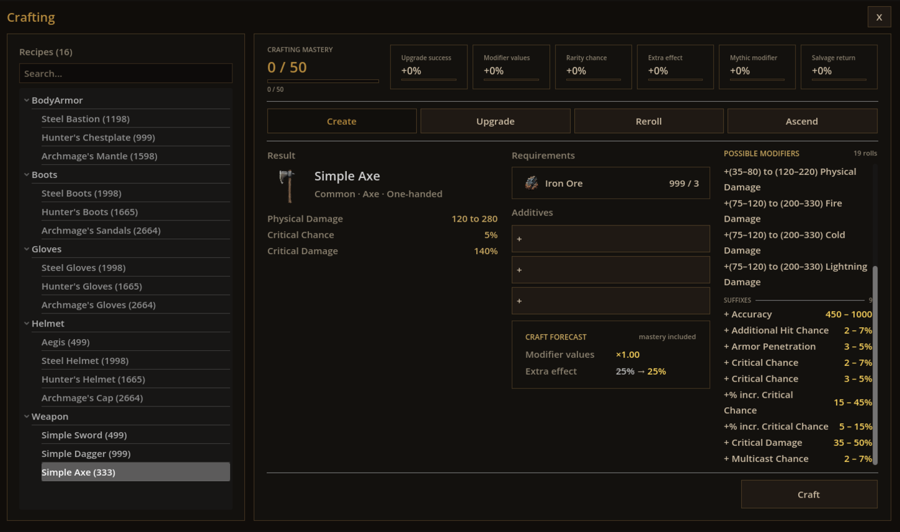
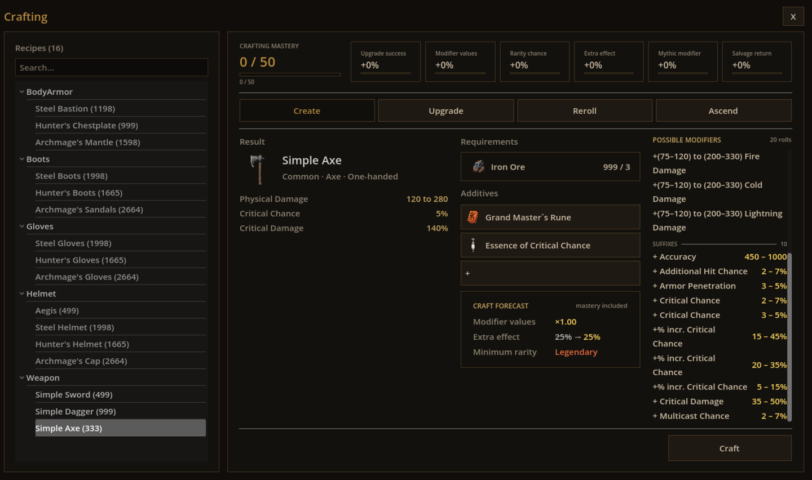
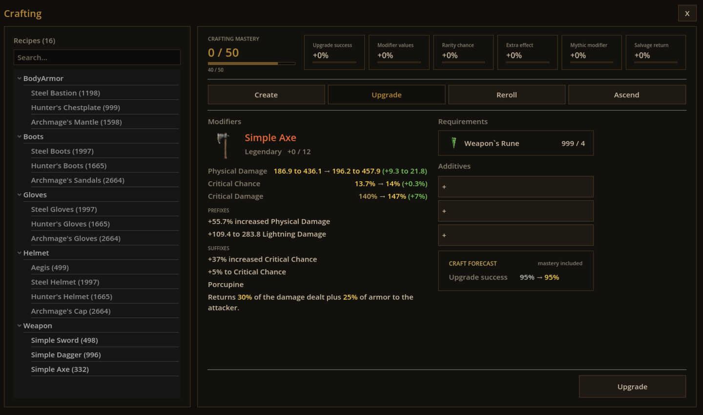
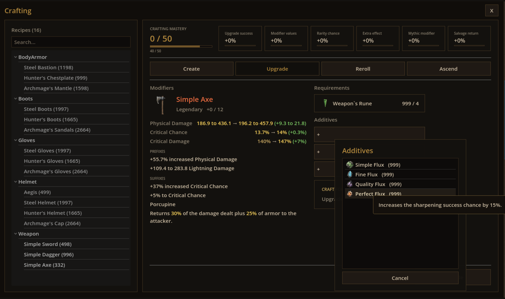
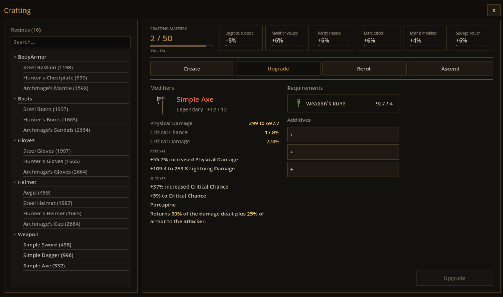
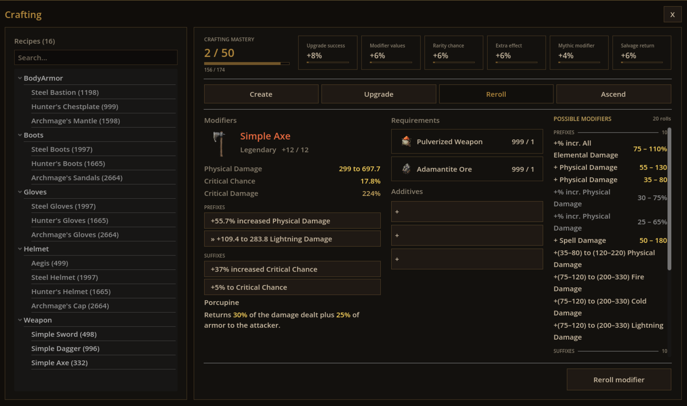
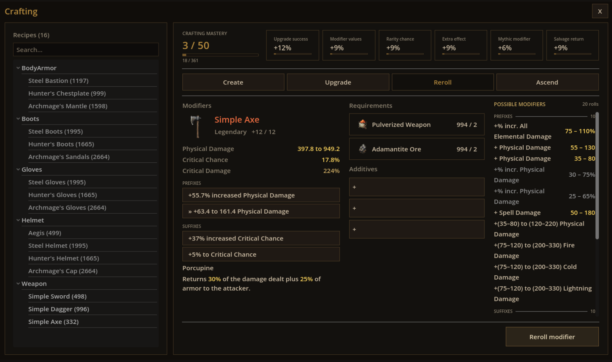
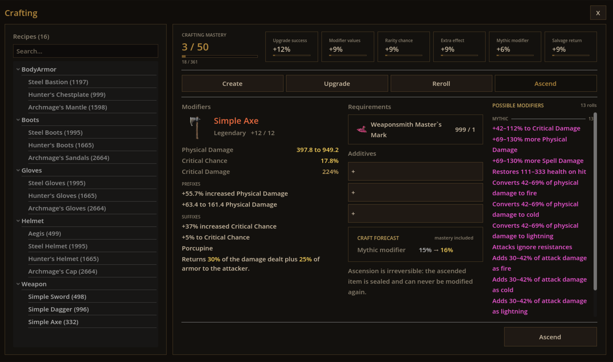
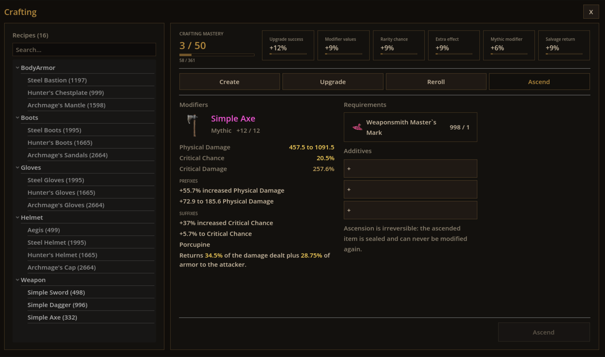
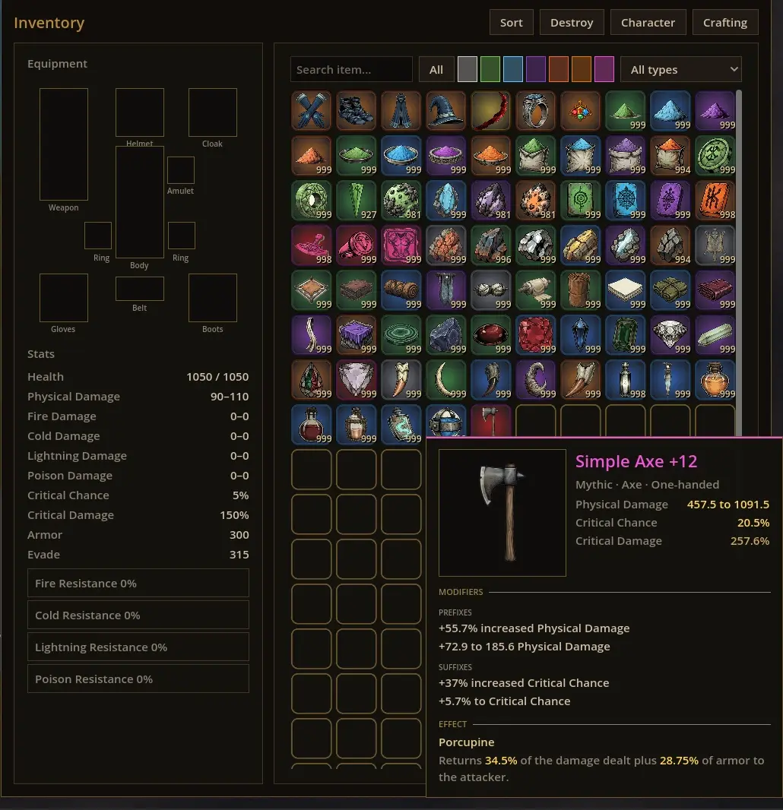

### Martial arts tree

Stance sectors of the passive tree, ability nodes with full descriptions and keyword tooltips.

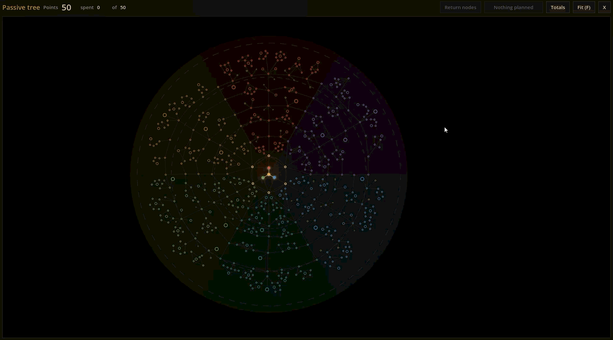
